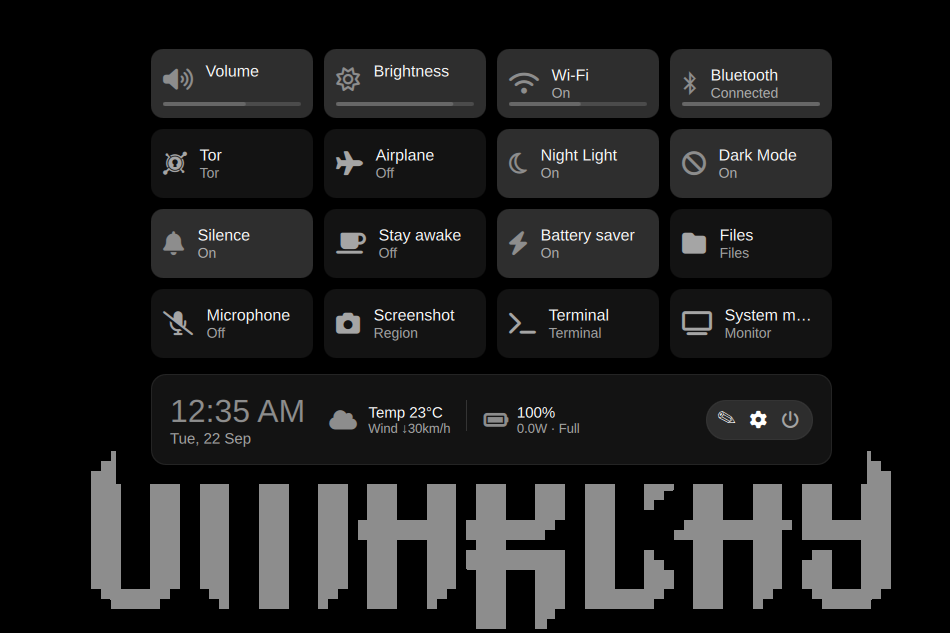

# Control Center for Omarchy

Quick settings for the [Omarchy](https://omarchy.org/) shell: Wi-Fi, Bluetooth, volume, brightness, and power in one popup.



## Install

```bash
omarchy plugin add https://github.com/404Prabhat/omarchy-control-center.git --enable
```

## Update / Remove

```bash
omarchy plugin update aryal.control-center
omarchy plugin remove aryal.control-center
```

## Use

Hover the top-left corner, or run:

```bash
omarchy-shell shell toggle aryal.control-center
```

Left-click opens a panel, right-click toggles. Edit mode rearranges the grid.

## What you get

- 4×4 grid of toggles, sliders, and actions
- Live volume, brightness, Wi-Fi, and Bluetooth meters
- Battery, weather, and power actions
- Missing tools just hide their tile

## Needs

Omarchy + Quickshell, JetBrainsMono Nerd Font. Optional: `nmcli`, `bluetoothctl`, `gsettings`, `brightnessctl`, `powerprofilesctl`, `btop`, `wl-screenrec` / `wf-recorder`, `tormarchy`. The Terminal, Files, System monitor, and Settings tiles open your Omarchy defaults (`omarchy-launch-terminal`, `xdg-open ~`, `omarchy-launch-tui btop`, the Omarchy menu) and fall back to `xdg-terminal-exec` / `foot`, `nautilus`, and `gnome-control-center` (or `systemsettings` / `xfce4-settings-manager`).

Runs locally as your user, no telemetry.

## Files

`manifest.json` · `Panel.qml` · `Model.js` · `control-center.json` · `EdgeSummon.qml`

## License

MIT — see [LICENSE](LICENSE).
